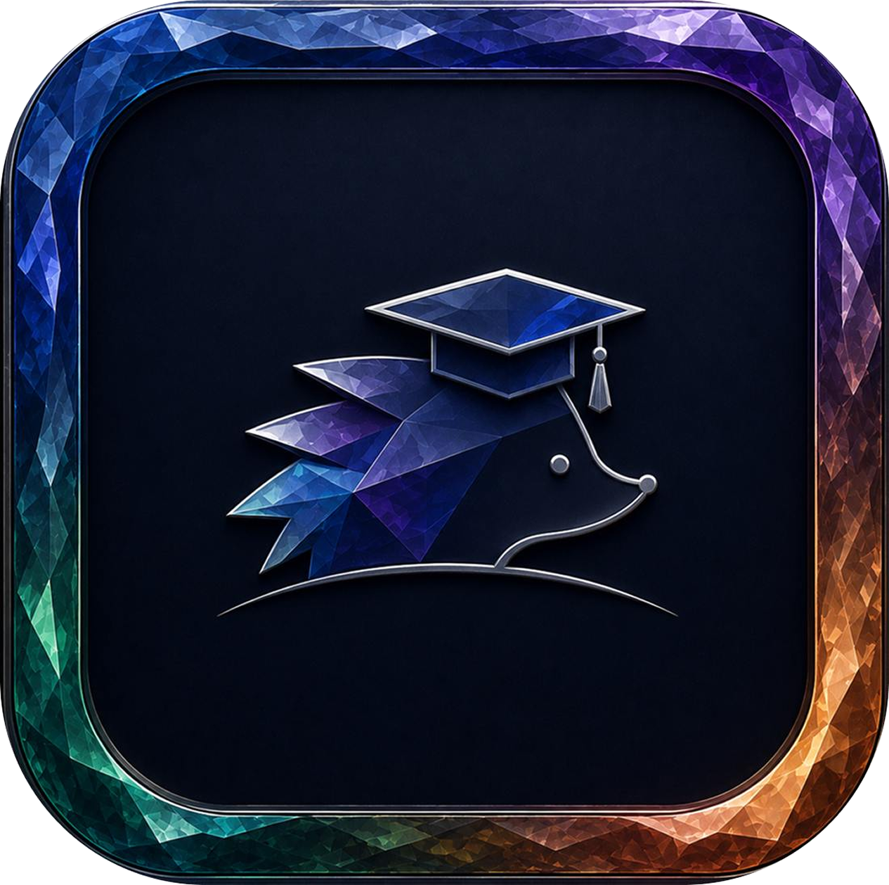

<div align="center">

<div align="center">
  
</div>

# 🛡️ Knowledge Base - База знаний по информационной безопасности

Интерактивная веб-платформа для изучения и анализа компетенций в области информационной безопасности. </br> Проект предоставляет визуальные инструменты для отслеживания навыков, симуляции сценариев и анализа корреляций между дисциплинами.

[]()
[]()
[]()
[]()

</div>

---

## ✨ Возможности

### Основные функции

- **🗺️ Карта компетенций** - Визуализация дисциплин по семестрам с цветовой кодировкой компетенций
- **� Цепочка дисциплин** - Интерактивное отображение учебного плана с тремя режимами просмотра:
  - По категориям (K1-K4)
  - По семестрам с отображением нарушений последовательности
  - Траектория обучения с визуализацией связей между предметами
- **🌳 Древо обучения** - Иерархическая структура образовательных элементов
- **�� Анализ корреляций** - Исследование взаимосвязей между навыками и дисциплинами
- **🎯 Симулятор сценариев** - Практическое моделирование изучения предметов
- **📈 Трекер прогресса** - Отслеживание развития навыков и достижений с бейджами
- **🔍 Поиск и фильтрация** - Удобные инструменты для навигации по базе знаний
- **📋 Дисциплины** - Детальный обзор всех учебных дисциплин с метаданными

### Визуализация

- **Интерактивные графы** - React Flow для отображения сложных связей между дисциплинами
- **Цветовая кодировка** - Уникальные цвета для каждой категории компетенций:
  - K1 (Голубой) - Общепрофессиональные дисциплины
  - K2 (Фиолетовый) - Дисциплины специализации
  - K3 (Изумрудный) - Дисциплины по выбору
  - K4 (Янтарный) - Факультативы
- **Анимации** - Плавные переходы с Framer Motion

## 🛠️ Технологии

### Frontend

- **Next.js 16** - React фреймворк для production
- **React 19** - Библиотека пользовательского интерфейса
- **TypeScript** - Типизированный JavaScript
- **Tailwind CSS 4** - Утилитарный CSS фреймворк

### UI & Анимации

- **Framer Motion** - Библиотека анимаций
- **Lucide React** - Современные иконки
- **React Flow (@xyflow/react)** - Диаграммы и графы

### Данные & Состояние

- **Zustand** - Легковесное управление состоянием
- **Recharts** - Графики и визуализация данных

### Инструменты разработки

- **ESLint** - Линтинг кода
- **PostCSS** - Обработка CSS
- **Docker** - Контейнеризация приложения

## 📁 Структура проекта

```
knowledge-base/
├── app/                          # Next.js App Router
│   ├── globals.css              # Глобальные стили
│   ├── layout.tsx               # Корневой layout
│   ├── page.tsx                # Главная страница
│   ├── correlations/           # Модуль корреляций
│   │   ├── curriculum-chain/   # Цепочка дисциплин
│   │   └── page.tsx            # Страница корреляций
│   ├── education-tree/         # Древо обучения
│   ├── simulator/              # Симулятор сценариев
│   └── tracker/                # Трекер прогресса
├── src/
│   ├── components/             # React компоненты
│   │   ├── ui/                # UI компоненты (Button, Tabs)
│   │   └── nodes/             # React Flow узлы
│   ├── data/                  # Данные приложения
│   ├── store/                 # Управление состоянием
│   ├── types/                 # TypeScript типы
│   ├── lib/                   # Утилиты
│   └── utils/                 # Вспомогательные функции
└── public/                    # Статические файлы
```
